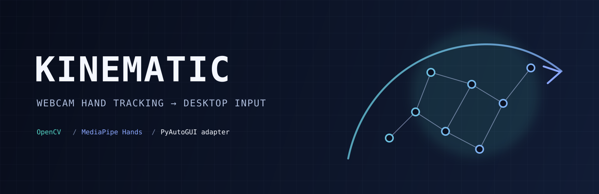

# Kinematic




[](https://www.python.org/)

Kinematic turns webcam hand landmarks into desktop pointer, click, and scroll input. It targets
Python developers building or testing gesture-driven input on macOS; the pipeline starts paused and
can run entirely against a recording adapter.

## Features

- Tracks one hand with OpenCV and MediaPipe Hands.
- Maps palm or wrist motion to the screen.
- Smooths cursor movement with One Euro or EMA filters.
- Recognizes left, right, and two-finger scroll gestures.
- Supports press-and-hold dragging, horizontal scroll, and rate limits.
- Provides dry-run output, diagnostics, JSON-lines logs, and testable adapters.

## Quick Start

### Prerequisites

- Python 3.9 or newer
- A webcam
- macOS Camera permission for the host process
- macOS Accessibility permission for real PyAutoGUI output

MediaPipe is pinned to `0.10.14` because this code uses its `mp.solutions.hands` API.

### Installation & Run

```bash
git clone https://github.com/Marvinoponopano/kinematic.git
cd kinematic
python3 -m pip install -r requirements.txt
python3 -m kinematic.main --dry-run
```

The dry run opens the preview and records output without moving the pointer. Press `q` or `Esc` to
quit. To enable real output, omit `--dry-run`; the application still starts paused.

The package also installs a console entry point:

```bash
python3 -m pip install .
kinematic --dry-run
```

## Controls and gestures

| Input | Action |
| --- | --- |
| `Space` or `p` | Pause or resume output |
| `q` or `Esc` | Quit |
| `]`, `=`, `+` | Increase pointer sensitivity |
| `[`, `-`, `_` | Decrease pointer sensitivity |
| `0` | Reset sensitivity to its startup value |
| Thumb + index pinch | Press and hold the left button |
| Thumb + middle pinch | Press and hold the right button |
| Thumb + index + middle pose | Scroll vertically and horizontally |
| Open hand, with `--gesture-pause` | Toggle pause after the configured hold |

The default pointer mode is absolute: the inner 70% of the camera frame maps to the screen. Use
`--pointer-mode relative` for displacement-based movement, or `--pointer-reference wrist` for a
more stable reference point.

## Useful commands

```bash
python3 -m unittest discover -s tests
python3 -m kinematic.main --dry-run --no-preview
python3 -m kinematic.main --diagnose --no-camera-probe
python3 -m kinematic.main --log-level info --log-file run.jsonl
```

`--diagnose` checks MediaPipe, the screen, Accessibility, configuration, and (unless skipped) the
camera. It exits non-zero when a check fails. Logs are JSON objects, one per line; the default log
level is `warning`.

## Development

The package keeps hardware at the edges:

- `kinematic/landmarks.py` converts MediaPipe results into plain landmark dataclasses.
- `kinematic/recognizer.py` contains the timestamp-driven gesture state machine.
- `kinematic/runtime.py` is the only module that calls an output adapter.
- `kinematic/output.py` contains the real and recording mouse adapters.

Run the complete test suite from the repository root:

```bash
python3 -m unittest discover -s tests
```

Tests use synthetic landmarks and `RecordingMouseOutput`; they do not require a camera, display,
Accessibility permission, or real pointer events.

## Safety

Real pointer output is opt-in. The runtime starts paused, `--dry-run` never constructs the real
adapter, and `Space` pauses output immediately. `q`, `Esc`, and `Ctrl-C` are emergency exit paths.
For an additional PyAutoGUI corner abort, construct `RealMouseOutput(failsafe=True)` in an
integration environment.

## License

MIT, as declared in `pyproject.toml`.
